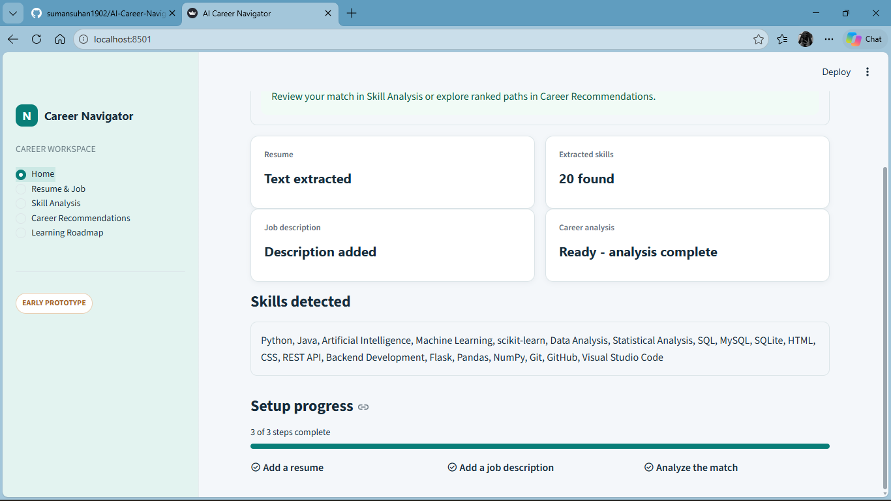
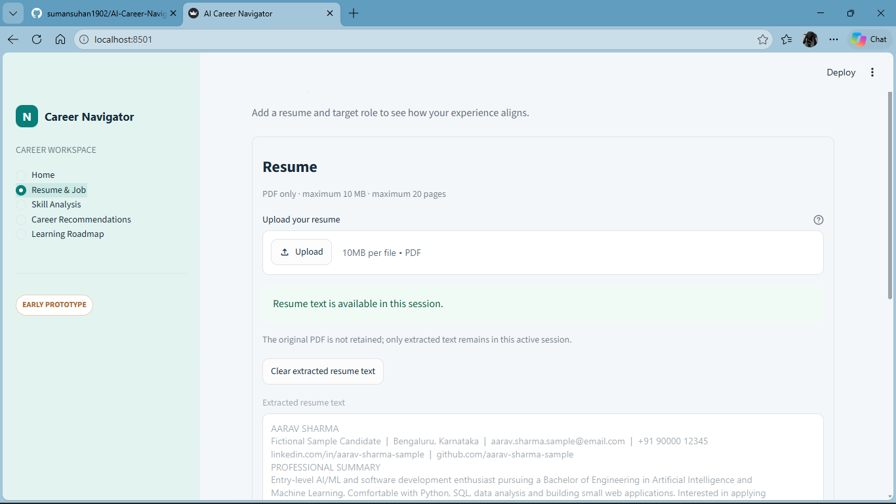
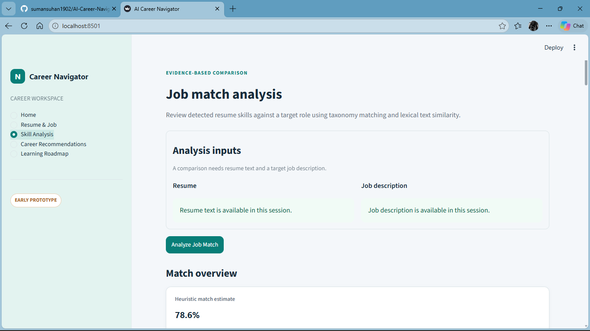
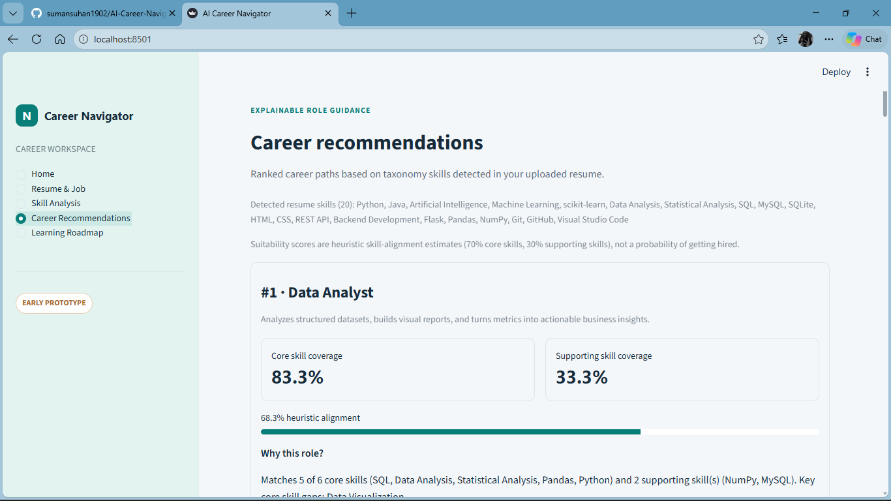
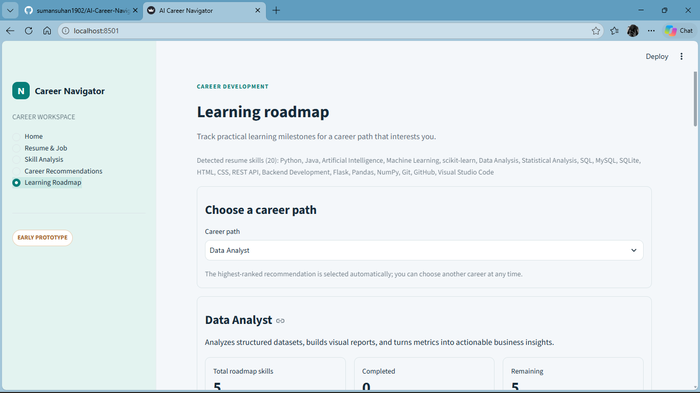

# AI Career Navigator

AI Career Navigator is an early Streamlit prototype for a career-guidance platform. It extracts resume text, identifies taxonomy skills, provides an explainable heuristic comparison with a target job description, and recommends ranked career paths based on detected resume skills.

## Problem Statement

Job seekers often need to translate varied experience into role-specific skills and compare that experience with changing job requirements. The intended platform will make that comparison easier to inspect and act on, while keeping recommendations grounded in evidence rather than presenting unsupported scores.

## Current Features

- Streamlit dashboard with sidebar navigation and workspace status indicators.
- In-memory PDF resume text extraction with PyMuPDF, with a 10 MB upload limit, a 20-page limit, PDF signature validation, and clear messages for empty, scanned, password-protected, oversized, and invalid PDFs.
- Extracted resume text displayed in a read-only text area. Uploaded resume bytes are not written to disk or persisted.
- Curated, JSON-backed skill taxonomy across programming, AI/ML, data science, databases, web development, frameworks/libraries, developer tools, and soft skills.
- Case-insensitive skill detection using canonical names, aliases, and word-boundary-aware regular expressions.
- Categorized candidate and job skills, plus exact-name matching and missing-skill lists, on the Skill Analysis page.
- On-demand job matching combining taxonomy skill coverage with TF-IDF cosine similarity, with categorized matches, missing requirements, additional candidate skills, strengths, and improvement suggestions.
- Resume text and job-description input held only in the active Streamlit session.
- Explainable career recommendations ranked by weighted core (70%) and supporting (30%) skill coverage across six curated roles (`data/careers.json`), with missing-skill gaps and suggested next skills to learn.
- Personalized learning roadmaps for career skills, with dependency-aware ordering, practical projects, milestones, and session-based completion tracking.
- SQLite connection helper for future persistence; it is not currently used by the app.

Skill extraction is deterministic taxonomy-based keyword matching, not an AI model or semantic NLP system. TF-IDF similarity is lexical and does not infer meaning. Both the job match score and the career suitability score are heuristic compatibility estimates, not probabilities of being hired. The engine does not evaluate proficiency or account for context and negation.

## Application Screenshots

### Home



*Home dashboard.*

### Resume & Job



*Resume and job workspace.*

### Skill Analysis



*Skill analysis.*

### Career Recommendations



*Career recommendations.*

### Learning Roadmap



*Learning roadmap.*

## Feature 05: Personalized Learning Roadmap

The **Learning Roadmap** dashboard page turns each curated career profile into an ordered plan for learning its skills.

### Roadmap architecture

- `data/careers.json` defines each career's core and supporting skills, while `data/skills.json` provides the canonical skill names and aliases.
- `data/learning_paths.json` provides learning metadata for all 37 career skills: a Beginner, Intermediate, or Advanced level, prerequisites, a practical mini-project, and a completion milestone. It does not depend on external course links or certifications.
- `modules/learning_roadmap.py` loads and validates the catalog against the canonical skill taxonomy and career profiles. It checks career-skill coverage, prerequisite references and levels, and circular dependencies before generating a roadmap.
- The roadmap engine orders missing skills so prerequisites come first and prioritizes core skills when dependencies allow. It groups steps by learning level and calculates completed skills, remaining skills, and the completion percentage.
- `app.py` provides the Streamlit interface, resume-based personalization, career selection, completion controls, and session-state progress handling.

### Personalization and progress

When resume text is available, the app extracts skills using the existing taxonomy and selects the highest-ranked career recommendation by default. Skills already detected in the resume are excluded from that career's learning steps. Users can choose another career. Without a resume, users can select any career and see its complete roadmap.

Each step includes its prerequisites, a practical project suggestion, and a milestone describing an observable outcome. The dashboard lists completed and remaining skills, groups the steps into Beginner, Intermediate, and Advanced stages, and displays overall progress. If the resume already covers all tracked skills for a career, the roadmap is empty and completion displays as **N/A** because no skills are being tracked.

Progress is separate for each career and is held only in Streamlit session state. It is retained while that active session continues, including when navigating between pages or switching careers. Progress is **not** written to SQLite, a file, or another persistent store, and is not guaranteed to remain available in a later session or after the active session ends.

## Technology Stack

- Python 3.11 or later
- Streamlit for the dashboard
- Pandas and NumPy remain available for future data preparation; the default matcher uses built-in Python data structures.
- SQLite through Python's standard-library `sqlite3` module
- PyMuPDF (`pymupdf`) for PDF text extraction
- Python regular expressions and a curated JSON taxonomy for deterministic skill extraction
- Optional scikit-learn TF-IDF vectorization and cosine similarity for lexical resume/job comparison

## Job Matching Engine

The Skill Analysis page runs the comparison only when **Analyze Job Match** is clicked. The engine reuses the skill extractor to identify canonical candidate and required skills, then reports:

- Matching skills and missing detected requirements
- Additional candidate skills not detected in the job description
- Strengths and improvement suggestions grounded in those results
- Skill coverage, TF-IDF text similarity, and a weighted overall estimate

### Matching algorithm

Skill coverage is computed only when resume text and at least one required taxonomy skill are available:

```text
Skill coverage (%) = matching required skills / total detected required skills * 100
```

Text similarity is the cosine similarity of L2-normalized TF-IDF vectors (unigrams and bigrams), expressed as a percentage. The default standard-library implementation avoids binary dependency issues in the current Windows environment. Set `AI_CAREER_NAVIGATOR_TFIDF_BACKEND=scikit-learn` to use scikit-learn's vectorizer and cosine similarity. The result measures shared vocabulary, not semantic similarity.

```text
Overall estimate (%) = 0.70 * skill coverage + 0.30 * text similarity
```

The overall estimate is unavailable if inputs are empty, required taxonomy skills are not detected, or TF-IDF cannot form usable vectors. Scores are heuristic comparisons of the supplied text, not hiring probabilities.

### Example

```python
from modules.job_matcher import match_job

analysis = match_job(
    "Python developer with experience building REST APIs.",
    "Looking for a Python developer with REST API experience and SQL.",
)

print(analysis.overall_match_score)
print(analysis.matching_skills)
print(analysis.missing_skills)
```

The taxonomy is intentionally curated and finite; unlisted skills and aliases will not be detected. Keyword extraction can miss paraphrases or match contextually irrelevant uses of a term. TF-IDF is sensitive to wording and cannot assess skill depth, proficiency, or experience quality. Pandas remains in the project dependency set but is not required for the current matching result structures.

## Installation

From the project directory, create and activate a virtual environment, then install the dependencies:

```powershell
py -m venv .venv
.\.venv\Scripts\Activate.ps1
python -m pip install -r requirements.lock.txt
```

`requirements.lock.txt` pins the resolved dependency versions and hashes. Update it intentionally when changing `requirements.txt`; the lock file is the reproducible installation source.

Run the application:

```powershell
python -m streamlit run app.py
```

The global light theme, including colors, typography, spacing, and widget styling, is configured in `.streamlit/config.toml`. App-owned visual components use the shared responsive rules in `assets/styles.css`, which preserves the theme's visual treatment for the brand mark, headings, metric cards, and status panels.

Run the complete offline-safe test suite:

```powershell
python -m unittest discover -s tests -p "test*.py" -v
```

## Project Structure

```text
AI-Career-Navigator/
├── app.py                       # Streamlit dashboard and input workflow
├── .streamlit/
│   └── config.toml              # Global Streamlit theme and 10 MB upload limit
├── assets/
│   └── styles.css               # Responsive styling for app-owned visual components
├── requirements.txt             # App runtime and optional analysis dependencies
├── requirements.lock.txt        # Pinned dependency versions and hashes
├── README.md                    # Project overview, setup, and implementation status
├── .gitignore                   # Python, local environment, secrets, and database exclusions
├── modules/
│   ├── __init__.py              # Analysis package marker
│   ├── resume_parser.py         # In-memory PDF text extraction
│   ├── skill_extractor.py       # Taxonomy-based skill extraction and comparison
│   ├── job_matcher.py           # Skill coverage, TF-IDF similarity, and explainable results
│   ├── career_recommender.py    # Explainable career path recommendations
│   └── learning_roadmap.py      # Validated catalog and dependency-aware roadmap engine
├── database/
│   └── db.py                    # SQLite connection helper; persistence not yet wired into the app
├── data/
│   ├── skills.json              # Curated canonical skills and aliases by category
│   ├── careers.json             # Curated career roles with core and supporting skills
│   └── learning_paths.json      # Per-skill levels, prerequisites, projects, and milestones
└── tests/
    └── test_app.py              # Unit and dashboard tests for parsing, matching, careers, and roadmaps
```

The dashboard has five navigable pages: **Home**, **Resume & Job**, **Skill Analysis**, **Career Recommendations**, and **Learning Roadmap**. Career recommendations and resume-personalized roadmaps are implemented and use the curated career and skill catalogs described above.

## Security and runtime notes

- PDF uploads are limited to 10 MB in Streamlit and the parser, and documents over 20 pages are rejected before text extraction.
- The parser validates a PDF header in the first 1,024 bytes and processes the upload in memory without writing the original file to disk.
- Windows Application Control blocked the installed scikit-learn/SciPy binary import in the development environment. The default standard-library TF-IDF implementation remains the verified backend; the optional scikit-learn backend has not been verified on a supported environment.

## Future Enhancements

- Expand and validate taxonomy coverage against representative resumes and job descriptions.
- Improve context-aware disambiguation and evaluate extraction precision and recall.
- Add consent-based persistence, retention controls, and database migrations.
- Expand automated tests for matching quality and accessibility.
